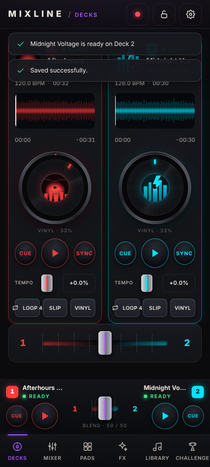

# Mixline 6

Mixline is a mobile DJ instrument: two audio decks with vinyl platters and waveforms, a mixer, performance pads, a filter × echo effects pad, a music library with open online sources, and a Challenge mode that cuts between queued videos. Version 6 is a complete recreation in the "neon performance instrument on obsidian" design language from the project's design boards: Deck 1 red, Deck 2 cyan, violet for creative controls.



## Workspaces

| Tab | What it does |
|---|---|
| **Decks** | Dual deck view with artwork, waveform, platter, CUE / PLAY / SYNC, tempo and quick loop. Tap a deck's artwork for the focus view: zoomable detail waveform with Seek / Pan / Scratch, EQ, tempo fader, hot cues, loop lengths and the other deck in a strip. |
| **Mixer** | Trim, three-band EQ with kill buttons, filter, channel faders with live meters, master level, mute and meter, Blend / Cut crossfader curve. |
| **Pads** | Per deck: eight hot cues (hold a pad to name, colour or clear), beat loops from 1/4 to 32 with In / Out / Exit, an eight-sound sampler, slip and beat jumps. |
| **FX** | Latched filter × echo XY pad with Bypass and Reset, filter / echo cards with on-off switches, reverb, feedback and echo time, and timed transitions (Blend, Bass swap, Echo out over 4 / 8 / 16 bars). Any manual move takes over. |
| **Library** | Search by title / artist / BPM, source chips, six original practice tracks, import from the device, Audius / Jamendo / Internet Archive / Wikimedia discovery with license checks, an inspector with waveform, preview, start point, loop In / Out, preparation (title, artist, BPM tap / analyse) and Load to Deck 1 / 2. Favourites, recents and crates with practice pairs and set recipes. |
| **Challenge** | Two visible YouTube decks with a video crossfader, NEXT · Deck 1 / CUT / NEXT · Deck 2, fade length, an optional local audio layer and the Up Next queue (start times, loop, reorder, remove with undo, skip). |
| **Settings** | Studio settings with search and explicit Save: crossfader curve, transition behaviour, safe level warning, haptics profile with a test cue, theme, deck colour palette (Red · Cyan or Violet · Teal), glow intensity, motion. Sessions (named, restore paused) and recordings (play, save to file, delete). |

The persistent dock keeps both deck identities, CUE / PLAY and the crossfader reachable in every audio workspace. The header has the master-bus record button and a performance lock that protects loading and deck replacement.

## Run it

**In a browser (desktop or phone on the same network)**

```bash
npm run serve           # http://127.0.0.1:8080
```

Open the address on a phone to test touch, or on a desktop to use the keyboard shortcuts (press `?` in the app for the list).

**Android test APK**

GitHub Actions builds a signed test APK on every push: open the latest *CI* run, download the **Mixline-APK** artifact and install `Mixline-6.0.0.apk` (Android 10+). A tag such as `v6.0.0` also attaches the APK to a GitHub release. To keep the APK installable as an update over an earlier test build, add the previous testing keystore as the repository secret `MIXLINE_KEYSTORE_BASE64` (base64 of `.signing/mixline-test.keystore`); without it CI generates a fresh testing key and the old test app must be uninstalled first (that removes its local library).

To build locally you need JDK 17+ and an Android SDK with platform 36 and build-tools 36.0.0:

```bash
export ANDROID_HOME=/path/to/android-sdk
bash scripts/build-apk.sh   # writes artifacts/Mixline-6.0.0.apk and its SHA256
```

## Testing

```bash
npm test                 # 103 unit tests: engine, analysis, sources, video, queue, library, loader, settings, sessions, store
npm run test:browser     # Playwright/Chromium journeys, control gestures and viewport evidence (needs the playwright package and Chromium)
```

Browser runs write screenshots and `results.json` files under `artifacts/`. The checked-in evidence for this release is in [docs/verification/6.0](docs/verification/6.0) and summarised in [docs/VERIFICATION-6.md](docs/VERIFICATION-6.md).

## Music sources and rights

- **Mixline Originals**: six synthesised practice tracks generated in code with their own cover art. No external samples.
- **Your files**: imported audio is stored on the device (IndexedDB) and survives relaunches; it is removed when app data is cleared.
- **Audius, Jamendo, Internet Archive, Wikimedia Commons**: search and preview; a track loads into a deck only after an explicit supported-license check. Jamendo needs a public Client ID (Library → Sources). Live access to each service was not verifiable from the build environment.
- **Spotify** is listed as not connected: DJ playback requires an approved partner integration.
- **YouTube** plays in Challenge through the official embedded players. That audio is never mixed into the audio decks or recordings.

## Project layout

```
web/                 the app (no build step): index.html, css/, js/core (engine, store, sources…), js/ui (controls), js/screens, js/shell
app/                 Android WebView shell (package com.mixline.studio.testing, version 6.0.0)
tests/               node unit tests (*.test.mjs) and browser journeys (tests/browser)
docs/                design spec and plan (docs/superpowers), design brief, verification report, device checklist, archived 4.0/5.0 material
.github/workflows/   CI: unit tests, browser journeys, APK build and release upload
```

## Known limits

Tempo changes alter pitch (no key lock); Sync is a one-time tempo match and phase alignment, not continuous beat sync; there is no headphone cue because the shell has one stereo output; recordings use the WebView's MediaRecorder format (WebM/Opus or MP4) with a 48 MB safety stop; physical-phone latency, haptics, interruptions and live online providers still need testing on the device (see [docs/DEVICE-TESTING.md](docs/DEVICE-TESTING.md)).

## Documents

- [Design specification](docs/superpowers/specs/2026-10-28-mixline-6-design.md) and [implementation plan](docs/superpowers/plans/2026-10-28-mixline-6-plan.md)
- [Design brief](docs/DESIGN-6.md) · [Verification report](docs/VERIFICATION-6.md) · [Device test checklist](docs/DEVICE-TESTING.md)
- [Archived 4.0 / 5.0 documentation](docs/archive/5.0)
